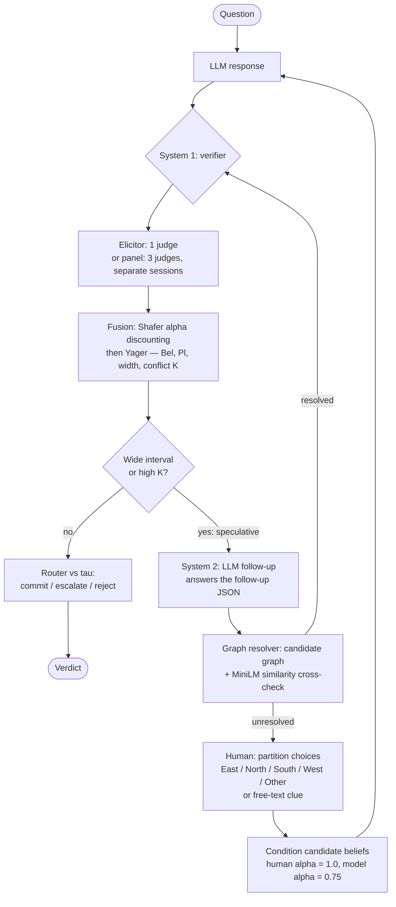

# Zydah

Evidential belief fusion for agent evaluation. Replace single LLM-as-judge /
majority vote with a judge panel whose masses are fused by deterministic
belief-fusion rules. The core library implements Dempster's rule, Shafer
reliability discounting, Yager's rule, and Smets' transferable belief model
(TBM); the live verifier pipeline defaults to Yager's rule. Dempster is a
comparison baseline and TBM is an optional rule, not the default pipeline
path. Conflict between judges is preserved as a signal, not normalized away.

## Building

A Dempster-Shafer+ belief-fusion evaluation agent. System 1 is deterministic
fusion, and System 2 is an LLM reasoner that handles only the high-conflict
or speculative cases. Conflict mass is a routing signal to use, not noise to
normalize away. The demo is closed-world only: it relies on the model's
trained state and the evidence supplied in the prompt. An open-world use of
Smets' TBM would require external evidence access — internet/web fetch or
another live source — which is not part of this demo.

## Why Zydah exists — Zadeh's paradox

Two strongly conflicting sources can break naive fusion. In the classic
medical example, two doctors agree a patient has one of {meningitis,
tumor, concussion} but assign near-opposite certainties; Dempster's rule
normalizes the conflict away and returns near-certainty in the one
hypothesis both doctors rated *least* likely. The failure is not the
evidence — it is treating conflict mass $K$ as noise to divide out.

Zydah takes the opposite position: $K$ and the [Bel, Pl] interval width
are kept visible and used as routing signals. High conflict or a wide
interval escalates to System 2 (or to a human) instead of being
normalized into false confidence; Yager's rule sends $K$ to ignorance
$\Omega$, and Smets' TBM leaves it on the empty set where it can be
detected as frame failure.

Full derivation, from first principles:
[Zadeh's Paradox, Yager, and Smets](<agent/docs/Zadeh's Paradox, Yager, and Smets A Derivation from First Principles.md>).

Dependability is tested with order-invariance checks, seed/flip variance,
and seeded synthetic harness baselines. No always-LLM cost baseline exists
yet.

Frame failure is detectable today: under `rule: tbm`, conflict landing on
the empty set is the alarm, and the local response is to suspend the
decision and escalate. Repairing the frame — supplying the correct
unlisted hypothesis — generally needs new evidence, which this
closed-world demo does not gather.

## Further RL Research

Bellman / temporal-difference (TD) routing is future research, not current
routing. A tabular TD(0)/Monte-Carlo learner has been ported and unit-tested
offline, and verifier trajectories are logged, but learned routing is not
wired. The next evidence step is live panel trajectories with three judge
masses, varying conflict K, episodes of two or more steps, and held-out
labels.

## Looking for

Feedback on reward design for process-level signals, and anyone working on
agent reliability or reasoning under uncertainty. Happy to compare notes!

P.S. Two doctors, one patient... Dempster says tumor. 🙂

> **Provenance:** new work built during the event, Oct 27 – Nov 4, 2026.
> Public repo; synthetic or public data only.

## Architecture



Full call tree, panel paths, and invariants:
[agent/docs/Pipeline Call Tree.md](<agent/docs/Pipeline Call Tree.md>).

## Thesis

- **Decision invariance under judge variability:** same evidence → same decision,
  even when individual judges vary run to run.
- **Escalate on evidence:** the verifier loop flags a wide [Bel, Pl]
  interval or high conflict mass K for follow-up; the router separately
  commits, rejects, or escalates on whether [Bel, Pl] straddles τ.
- **Decide on belief intervals** with per-domain thresholds
  (τ = 0.80 general, 0.95 high-stakes):
  commit if Bel ≥ τ, reject if Pl < τ, escalate if the interval straddles τ.

## Layout

- `agent/` — fusion core (`zydah/`), judge panel, router, eval harness, and
  tests. See [`agent/README.md`](agent/README.md) for details.

## Quickstart

Requires [uv](https://docs.astral.sh/uv/) (`brew install uv`). uv manages the
virtualenv and provisions the pinned Python 3.12 from `.python-version` — do
not use `pip` or `python -m venv`.

```sh
cd agent
uv sync --extra dev
uv run pytest
```

The test suite runs fully offline: no API keys, no network, no model calls.
The live demo needs model credentials in `agent/.env` — see
[`agent/README.md`](agent/README.md) for the demo flags and panel options.
